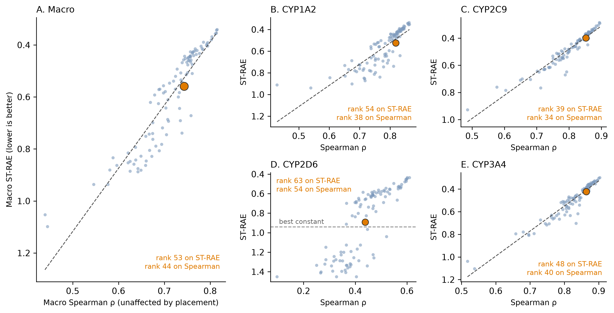
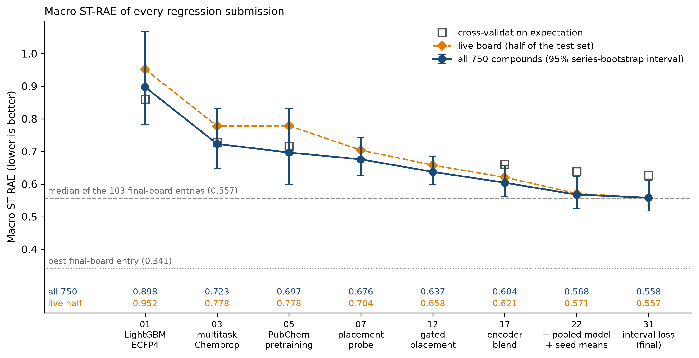
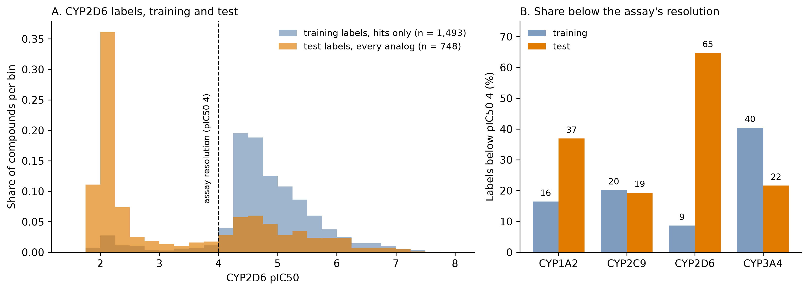

# CYP Challenge #2: CYP2D6 was hard and now I understand better why

*November 2026*
Tag: blind challenge

---

The final deadline of the OpenADMET CYP inhibition challenge passed on November 3, and the organizers released the test labels the next day.
The final board lists only the entries that linked a model: 103 for direct inhibition (regression) and 62 for time-dependent inhibition (TDI).
My regression submission is at rank 53 with a macro ST-RAE of 0.5589 (field median 0.5567, best 0.3409).
My TDI submission is at rank 44 with a macro MCC of 0.2989 (median 0.3249, best 0.498).

That is the middle of the field for regression, and a better score than the interim board gave me in September (0.6384), though the fields differ, so I compare scores and not ranks.

In [the last post](2026_10_20_cyp_phase1.html) I said the post at the end of the challenge would report how it all held up on the final labels.
The labels let me score every submission on all 750 test compounds, where the live board only ever scored half of them, and look at where the errors are.

In this post I will cover:
- what I tried after the interim reveal, and what each step bought in cross-validation (CV)
- how my score moved on the live half and on all 750 compounds
- what the test labels show, mainly why CYP2D6 was so hard

The short version is that blending decorrelated models, adding a model trained on public rows, and training against the credible interval each gained a resolvable amount, and CV put them in the right order.
However, CYP2D6 barely moved in this second phase and I now have concrete evidence as to why.
Training labels exist only for hits, and 65% of the CYP2D6 test labels are below pIC50 4, against 9% in the training set.

TDI gets a few paragraphs, because regression took most of my time.
The code is in the [public repository](https://github.com/adlvdl/cyp_competition).
The notebooks are numbered 16 to 32, and [notebook 33](https://github.com/adlvdl/cyp_competition/blob/main/notebooks/33_phase2_review.py) redraws every figure below from their outputs, the released labels and dated snapshots of the leaderboards.

---

## Part 1: What I tried after the interim reveal

The previous post ended with three open items (train on pooled public labels, put an interval on the pretraining gain, decide whether placement stays) and one guess, that the gap to the leaders was the encoder.
I took these in a different order and added ideas from other teams' public reports.

*Left: what each phase 2 lever bought in CV, as the change in macro ST-RAE with a fold-level 95% interval. Green and red mean the interval excludes zero, gray that it does not. Right: the three steps I submitted, in CV and on all 750 test compounds. The CV side cannot contain placement or seed means.*

**A different frozen encoder was the largest single gain (notebook [16](https://github.com/adlvdl/cyp_competition/blob/main/notebooks/16_encoders.py)).**
CheMeleon, the encoder under most of my frozen-embedding results, was pretrained on 2D graphs.
I tested two frozen 3D encoders with the same TabICL readout, so only the embedding changes: Monroe (pretrained on PM6 properties and PCBA assays) and Atom-JEPA (pretrained on conformers).
**Monroe scores a macro ST-RAE of 0.7020 against 0.7638 for CheMeleon (−0.0618, 95% CI −0.0678 to −0.0557, 25 folds), and is better on all four endpoints.**
Atom-JEPA is not better than CheMeleon (0.7751).

Monroe's PCBA pretraining contains the Veith CYP panel that the challenge derives from.
Only 225 of the 4,905 training compounds (4.6%) and 1 of the 750 blind compounds have a label there, and dropping the 225 from CV moves Monroe's macro score from 0.7020 to 0.7015.

**Blending paid even though the members correlate (notebooks [17](https://github.com/adlvdl/cyp_competition/blob/main/notebooks/17_regression_ensemble.py) and [18](https://github.com/adlvdl/cyp_competition/blob/main/notebooks/18_shift_check.py)).**
In the previous post I said a blend has nothing to average away when its members correlate at 0.87 to 0.96, as my four Chemprop variants did.
Monroe and `pubchem` correlate at 0.77 to 0.90, and a 50/50 blend of them beat `pubchem` on all 25 folds (0.6660 against 0.7160).
So my rule of thumb was wrong in one direction.
Notebook 17 measured what each of 20 candidates adds to that blend, and neither the correlation of predictions nor of errors ranked them.
The four tree models had the lowest error correlation with the blend and made it worse, because they are weak on their own.
A candidate has to be both decent and different.

I compared three pools, fitted per endpoint with Caruana selection and scored out of sample with respect to the weights: A (Monroe and `pubchem`), B (A plus Atom-JEPA and CheMeleon) and C (all 20 candidates).
Against `pubchem` alone they change macro ST-RAE by −0.0505, −0.0556 and −0.0648, each on 25 of 25 folds.
Larger ensembles helped, but by small increments, and I was not sure they would reproduce on the test set.
Notebook 18 reweighted the out-of-fold predictions toward the blind set on two axes I could measure without labels.
At 300 compounds per endpoint C beat B in 88% of resamples unshifted and in 70 to 79% shifted, so C's advantage was not resolved at sample sizes like the test set's.
I submitted B because it was simpler.

**Seed noise in the final fits was real (notebook [19](https://github.com/adlvdl/cyp_competition/blob/main/notebooks/19_seed_spread.py)).**
I had never passed a seed to Chemprop, and TabICL turned out not to be deterministic either.
Across five seeds the mean Spearman between pairs is 0.93 to 0.98 for `pubchem` (worst on CYP2D6), with a per-compound standard deviation of 0.10 to 0.15 pIC50.
From submission 22 on, every blind member is a seed mean.
CV has no seed-averaged out-of-fold predictions, so I could not measure the gain and estimated it at 0.003 to 0.005.
All five fits start from one pretrained checkpoint, so the pretraining gain still has no interval of its own.

**A model trained on public rows is worse alone and improves the blend (notebooks [20](https://github.com/adlvdl/cyp_competition/blob/main/notebooks/20_pooled_workbench.py) and [21](https://github.com/adlvdl/cyp_competition/blob/main/notebooks/21_pooled_ensemble.py)).**
The recipe is SuperCowPowers' ([working notes](https://supercowpowers.github.io/workbench/blogs/cyp_challenge/), [code](https://github.com/SuperCowPowers/workbench/tree/main/ml_pipelines/OpenADMET/cyp)), which I replicated from their description.
It is one multitask Chemprop trained from scratch on the challenge rows plus public rows (PubChem qHTS and ChEMBL 37), with 17 output heads: the four scored endpoints and 13 auxiliary and public ones.
Alone it loses to `pubchem` (0.7382 against 0.7160, better on only 5 of 25 folds).
Added to pool B it gains −0.0214 (CI −0.0248 to −0.0181) on 25 of 25 folds, on every endpoint.
It correlates with `pubchem` at 0.72 to 0.88, against 0.87 to 0.96 among the Chemprop variants, and I think that decorrelation is the reason.

**Training against the credible interval (notebooks [28](https://github.com/adlvdl/cyp_competition/blob/main/notebooks/28_interval_loss.py) to [31b](https://github.com/adlvdl/cyp_competition/blob/main/notebooks/31b_interval_blend_check.py)).**
ST-RAE is zero for a prediction inside a compound's credible interval, so the matching training loss is the distance to the nearest bound, `relu(low − prediction) + relu(prediction − high)`.
I had only ever trained on the point estimate.
The idea is in the reports of mokhalaf22 ([REPORT.md](https://github.com/mokhalaf22/openadmet-cyp-public/blob/main/REPORT.md)) and doctawho42 ([method report](https://github.com/doctawho42/CYPChallenge/blob/main/docs/method_report.md)), which I read on October 25, taking ideas only and no code or data.
Chemprop has no such loss, so I rebuilt each compound's band inside the Chemprop subprocess from its own pIC50, with an isotonic lookup fitted to the challenge's reported bounds.

On the shipped `pubchem` model the interval loss gains −0.0265 over L1 (CI −0.0335 to −0.0194) and −0.0458 over the MSE configuration I had used since notebook [05](https://github.com/adlvdl/cyp_competition/blob/main/notebooks/05_auxiliary_data.py).
The gain is on CYP1A2, CYP2C9 and CYP3A4 and not on CYP2D6 (−0.001, p = 0.71).
I think CYP2D6 has little for the loss to use, since its training intervals are the tightest and only 8.6% of its labels sit below pIC50 4, but I did not test that.
Spearman does not move, so the gain is in position relative to the bands and not in ordering.
On the pooled model the loss is worse on CYP2D6 (+0.026), so the shipped CYP2D6 pooled seeds keep L1.

**Fixed-moment placement erases most of that gain (notebook [31b](https://github.com/adlvdl/cyp_competition/blob/main/notebooks/31b_interval_blend_check.py)).**
Inside the blend, swapping in the interval-loss `pubchem` gains −0.0159 (CI −0.0183 to −0.0135).
Mapping each endpoint of the blend onto fixed moments, as the placement in submissions 12, 17 and 22 does, leaves −0.0023 (CI −0.0045 to −0.0002).
The loss works by moving the mean and the spread of the predictions, and a fixed-moment placement overwrites exactly that.
So the final submission leaves CYP2C9 and CYP3A4 unplaced and keeps the placement on CYP1A2 and CYP2D6, where it had paid on the live board.

**3D geometry did not matter (notebooks [25](https://github.com/adlvdl/cyp_competition/tree/main/experiments/25_xtb_conformer_probe) and [26](https://github.com/adlvdl/cyp_competition/blob/main/notebooks/26_monroe_conformers.py)).**
Oleg Gromov (Shorku on the challenge board) published xTB conformer ensembles for every challenge compound under an MIT license ([repository](https://github.com/Shorku/OpenADMET_Blind_Challenge_Predicting_CYP_Inhibition)).
Swapping the lowest-energy xTB conformer for an RDKit one moves Monroe's embedding 1.1 times as far as changing the RDKit random seed, and in CV the geometry step is −0.0009 (CI −0.0031 to +0.0015).
I shipped none of it, and I read the result as Monroe's embedding being set by the graph and not by the coordinates.

TDI took three notebooks ([23](https://github.com/adlvdl/cyp_competition/blob/main/notebooks/23_tdi_encoders.py), [27](https://github.com/adlvdl/cyp_competition/blob/main/notebooks/27_tdi_prior_and_gate.py) and [29](https://github.com/adlvdl/cyp_competition/blob/main/notebooks/29_tdi_blend_a1.py)) and one submission, which Part 2 covers in a few sentences.

---

## Part 2: The final leaderboard, and how the score moved

The final board scores all 750 compounds, as the interim board did, so my September and November numbers are on the same compounds even though the fields differ.

| Endpoint | ST-RAE | Rank | Field median | Best | Spearman | Rank |
|---|---|---|---|---|---|---|
| CYP1A2 | 0.5237 | 54 | 0.5179 | 0.3356 | 0.8189 | 38 |
| CYP2C9 | 0.3978 | 39 | 0.4398 | 0.2849 | 0.8524 | 34 |
| CYP2D6 | 0.8914 | 63 | 0.7120 | 0.4351 | 0.4382 | 54 |
| CYP3A4 | 0.4228 | 48 | 0.4617 | 0.2979 | 0.8637 | 40 |
| **Macro** | **0.5589** | **53** | 0.5567 | 0.3409 | 0.7433 | 44 |

On CYP2C9 and CYP3A4 I am better than the median entry on both metrics, and on CYP1A2 I am at the median on ST-RAE and above it on Spearman.
On CYP2D6 my ordering is at the median (Spearman 0.4382 against 0.4426) and my ST-RAE is not (0.8914 against 0.7120).
The organizers' significance tiers put me in Tier 13 of 29, together with ranks 52 to 56, a tier that includes the median entry.

*Where I sit among the 103 entries on the final board. A: macro ST-RAE against macro Spearman. Spearman does not depend on placement, so the distance from the dashed field trend is what placement and calibration add beyond ordering. B to E: the same per endpoint. CYP2D6 has no trend line because the field splits into two clusters, and the dashed horizontal line is the ST-RAE of the best constant predictor (0.941).*

The gap to the best entry shrank since the interim board, from 0.27 macro ST-RAE to 0.22.
The relation between my ordering and my score also reversed.
In September my ST-RAE rank (78) was better than my Spearman rank (119), and I credited placement.
Now my Spearman rank is better than my ST-RAE rank on every endpoint, and I sit 0.033 above the field trend where I sat 0.053 below it in September.
The board does not say why the placement advantage went away, and I have no evidence beyond the possibility that other teams read the same public notes.

On CYP2D6 the field splits in two: 30 of the 103 entries score above 1.2, which is worse than a constant, and 57 score below 0.8.
My 0.8914 sits between the clusters.
Among the 36 other entries whose CYP2D6 Spearman is within 0.04 of mine, 28 have a lower ST-RAE than I do, with a median of 0.686.

**All 750 compounds, and the live half.**
I scored every submission on all 750 compounds, with intervals from a bootstrap that resamples whole series of analogs (136 clusters), because analogs of one hit move together.
My scorer reproduces the final board to within 0.003 per endpoint.

*Macro ST-RAE of every regression submission, on all 750 compounds with a 95% series-bootstrap interval, on the live board (half of the test set) and as expected from CV. The intervals on single scores overlap from submission 12 on, so the evidence is in the paired step differences in the table below.*

Macro ST-RAE went from 0.898 for the day-one LightGBM on ECFP4 to 0.558 for the final file, a change of −0.339 on all 750 compounds.
The three phase 2 steps, paired on the same compounds:

| Step | What changed | All 750 compounds | CV expectation |
|---|---|---|---|
| 12 → 17 | Monroe, Atom-JEPA, CheMeleon and `pubchem` blended | −0.033 (95% CI −0.053 to −0.018) | −0.056 |
| 17 → 22 | pooled model and seed means added | −0.037 (−0.051 to −0.020) | −0.021 |
| 22 → 31 | interval loss in two members, placement gated | −0.010 (−0.016 to −0.004) | −0.012 |

Each of the three is resolved on all 750 compounds, and CV had them in the right order.
The earlier PubChem pretraining (−0.027, CI −0.055 to +0.010) and the placement probe (−0.021, CI −0.158 to +0.075) are not resolved on this test set.

**CV ordered the steps correctly and put the level too high.**
It expected 0.660, 0.639 and 0.627 for the last three submissions, and the test scored 0.604, 0.568 and 0.558, which is 0.056 to 0.071 lower.
I cannot say how much of that gap is placement, which CV cannot see, and how much is the shift in the label distributions described in Part 3.

**The live half flattered CYP2D6.**
The live board and all 750 compounds agree on the macro for the final file (0.5573 and 0.5580), but that is cancellation.
CYP2D6 scored 0.8890 on all 750 compounds against 0.7997 on the live half, while the other three endpoints scored 0.012 to 0.047 better.
I cannot separate a harder hidden half from a placement fitted to the live half that transferred less well, because the live half's membership is not published.

**The live rank went the wrong way while the score improved.**
On the live board my score improved at every submission and my rank did not (84 of 250 at submission 12, 74 of 261 at submission 31).
All of the top 15 entries on the final board were last submitted between October 31 and November 3.
My regression file is from October 26 and my TDI file from October 23, so the front of the field was still moving in the last week and my files were not.

**TDI.**
The TDI file is the six-arm blend of notebook [24](https://github.com/adlvdl/cyp_competition/tree/main/submissions/24_tdi_encoders): TabICL on frozen CheMeleon, Monroe and Atom-JEPA embeddings, plus three Chemprop variants, thresholded at 0.25.
It scored a macro MCC of 0.2989 on all 750 compounds, up from about 0.21 and 0.20 for the two files I had on the board in September.
It beats the earlier ensemble of notebook [14](https://github.com/adlvdl/cyp_competition/blob/main/notebooks/14_tdi_ensemble.py) by +0.066 (CI +0.017 to +0.116) and cannot be told apart from the day-one LightGBM on ECFP4.
The +0.02 CV gain of that earlier ensemble did not transfer.

---

## Part 3: What the test labels show

The labels let me ask a question I could not ask before, which is whether the test set is drawn from the population I trained on.
Every CV number in my repository assumes that it is.

**The test set is not the training population.**
Training labels exist only where the primary screen flagged a hit, so every training pIC50 is a hit's.
The test set is made of analogs of 75 hits chosen on CYP1A2, CYP2C9 and CYP3A4 activity, and every compound got a dose-response curve on all four isoforms whether or not it was active.
For CYP2D6 that gives a test set with a mean pIC50 of 3.27 against 4.78 in training, 65% of its labels below pIC50 4 against 9%, and 55% below 2.5, in a spike at the assay's floor.

*A: CYP2D6 labels as the share of compounds per 0.25 pIC50 bin, for the training set (hits only) and the test set (every analog). B: share of labels below pIC50 4, the assay's resolution, for each endpoint. CYP2D6 moves from 9% to 65%, and CYP3A4 moves the other way.*

CYP1A2 shifted the same way, less severely.
CYP2C9 and CYP3A4 shifted up, so their test sets are 81% and 78% active.
I think part of why those two scored well is that their test populations resemble their training populations, which means scores are not on equal footing across isoforms.

CV could not see any of this.
Out-of-fold predictions are scored against hit-only labels, so CV rewards ranking among hits and never rewards telling an inactive from an active.
It is the PXR lesson in a different form (there the hit rate went from 1.6% to 8.1%), and I did not apply it.
The size of the shift could not be seen without blind labels, but I think its direction on CYP2D6 could: the training labels were hits only, and the test compounds were analogs of hits chosen for other isoforms.
I should have modeled that expected bias more directly.

**Where the CYP2D6 error comes from.**
- The floor is nearly free. The 441 compounds with a true pIC50 below 3 have very wide intervals and contribute 0.6% of the error.
- The error is in the 289 compounds with a true pIC50 of 3.5 or more, which contribute 99% of it. I predicted them 1.2 to 1.9 pIC50 too low.
- The predictions are compressed, not shifted. The predicted mean is 3.11 against a true 3.27, but the predicted standard deviation is 0.54 against 1.48, and the highest prediction in the file is 5.12.
- The best constant predictor scores 0.941, so my whole stack bought 0.052 over a constant on CYP2D6. On the other three endpoints the best constant scores 0.98 to 1.00 and my file 0.40 to 0.52.

*A: shipped CYP2D6 prediction against the truth for the 748 labeled test compounds. The gray bars are the credible interval, so a point inside its bar costs nothing. B: mean prediction minus truth by true pIC50 bin. The floor compounds (left) are over-predicted and free. The potent compounds (right) are under-predicted on every endpoint, and by 1.2 to 1.9 on CYP2D6.*

The first thing I did to CYP2D6 was move its mean from 4.53 to 3.11 on the strength of the board's returned scores.
The labels explain why that was the largest single gain on the endpoint: the true mean is 3.27.
It fixed the center and left the range.

**Ordering is ordinary, and separating actives from inactives is not.**
Among the compounds with a pIC50 of 4 or more my Spearman on CYP2D6 is 0.655, similar to the 0.653 on CYP1A2.
The active-versus-inactive AUC (pIC50 of 4 or more against below 3) is 0.77 on CYP2D6 and 0.96 to 0.98 on the other three.
Assay noise is not the limit, since the rank ceiling set by the reported standard deviations is 0.99 among actives.
Series matter more than single compounds: 55% of the variance in CYP2D6 pIC50 lies between series, and of 136 series, 55 are entirely inactive and 25 entirely active.
Most of the task is deciding which series is active before ranking inside it, and where the nearest training compound has an ECFP4 similarity below 0.45 (48% of the CYP2D6 test compounds), Spearman among actives falls to 0.12 to 0.18.

**The release held the information I needed, and I had rejected it.**
The training release includes a single-concentration screen of 4,376 compounds on all four enzymes, and the compounds with a dose-response pIC50 are the ones the screen flagged for that enzyme.
For CYP2D6 that leaves about 2,880 compounds whose pIC50 I never had and whose inactivity was recorded.
As a controlled probe I trained LightGBM on ECFP4 with two sets of rows: the hit-only pIC50 labels that every notebook of mine used, and screen hit against non-hit over all screened compounds.
Scored as rankers of test actives against inactives, the first gives an AUC of 0.645 and the second 0.815, which is above the 0.765 of my shipped ensemble.

*A: how well the shipped file separates actives from inactives on each endpoint, and for CYP2D6 two LightGBM models on ECFP4 trained on different rows. B: CYP2D6 ordering among actives by similarity to the nearest CYP2D6 training compound.*

The effect is specific to CYP2D6, where the screen hit rate (34%) matches the test active rate (35%).
For CYP3A4 and CYP2C9 the test sets are 78% and 81% active, and the same classifier is weak or below chance (AUC 0.36 and 0.59).
I had tried versions of this in notebook 05, and CV rejected them.
The conclusion I drew, that the screen is a weak lever, was a property of my evaluation and not of the data, because it judged them on hit-only out-of-fold labels.
What this does not show is the gain inside the Chemprop and Caruana stack.
I formed the classifier idea after seeing the label distributions, ran it once and did not tune it, so read it as an existence proof.

**The pharmacophore I spent three notebooks on is absent on the test set.**
The basic-nitrogen flag correlates with CYP2D6 potency at +0.276 in the training labels and at −0.017 on the test labels.
In training, compounds with and without a basic nitrogen are 97.5% and 87% active, and on the test set 34% and 36%.
Notebooks [09](https://github.com/adlvdl/cyp_competition/blob/main/notebooks/09_cyp2d6_representation.py) to [11](https://github.com/adlvdl/cyp_competition/blob/main/notebooks/11_docking_3d.py) found that the pharmacophore is real and gives a model nothing it lacks, and that stands for the training population.
On the test population it separates nothing, so there was nothing for a better feature to recover.
This is the binary heuristic, and I did not re-test the pKa-weighted version.

**Placement, again.**
The previous post ended on the placement question: did the solve describe the test set, and did the placement transfer?
The solved means are within 0.02 of the true ones on three endpoints and within 0.16 on CYP2D6.
The solved spreads are within 8% on three endpoints and 25% too narrow on CYP1A2.
The live half's membership is not published, so this is a comparison and not a test.
The solve needs the Pearson correlation, which the board does not report, so I converted the Spearman it does report by assuming normality.
That underestimated CYP2D6, as I had suspected (0.365 against a measured 0.472), because the labels are a floor spike plus a tail.

So the solve was fine, and what did not hold was the spread I gave my own predictions.
The next table gives the best affine map of my shipped file, a stretch about its mean plus a shift, scored on the test labels.

| Endpoint | Shipped | Best constant | Best affine map of my file | Stretch | Shift |
|---|---|---|---|---|---|
| CYP1A2 | 0.5237 | 0.985 | 0.436 | 1.6 | 0 |
| CYP2C9 | 0.3976 | 0.996 | 0.372 | 1.225 | 0 |
| CYP2D6 | 0.8890 | 0.941 | 0.625 | 1.525 | +0.6 |
| CYP3A4 | 0.4219 | 0.990 | 0.378 | 1.15 | +0.15 |
| Macro | 0.5580 | 0.978 | 0.453 | | |

This uses the test labels, so it measures the headroom in my ordering and not a score I could have chosen blind.
The best stretch is wider than what I shipped on every endpoint, and on the final board a macro of 0.453 would be rank 33 instead of 53.
I set the shipped spreads from the ST-RAE optimum measured on out-of-fold predictions (CYP1A2), from the R²-optimal spread with the underestimated Pearson (CYP2D6), or from the spread of the blend (CYP2C9 and CYP3A4).
Out-of-fold predictions come from the training population, and I think that is why the measured shape did not carry over.

**What the labels change about my unease.**
In the previous post I was conflicted about solving for the hidden test set's mean and spread from the board's returned scores.
On the reading that this is ordinary use of public feedback, the board is how I learned that CYP2D6 was a different population, which CV could not show me, and the correction carried over: at the macro, the placed submissions score the same or better on all 750 compounds than on the live half (0.5580 against 0.5573 for the final file).
CYP2D6 is the exception, at 0.07 to 0.09 worse.
On the reading that this is information nobody meant to release, it took only one or two scored submissions per endpoint to recover the first two moments of the hidden labels.
Thirty of the 103 entries score above 1.2 on CYP2D6, worse than the 1.16 my first submission scored, so I doubt the trap I fell into was rare.
I am still conflicted, for the same two reasons.

**TDI has the same problem on CYP2D6.**
Its positive rate on the test set is 5.9% against 21.7% in training.
TDI is a shift in pIC50, so a compound that is inactive in the direct condition has little to shift: the TDI rate is 12% among direct-active compounds and 2.5% among the rest.
150 of my 209 predicted CYP2D6 positives are direct-inactive, and the precision is 12%.

---

## What I take from this

The result I trust most is the order of the steps.
Blending decorrelated members, adding a model trained on public rows, and training against the credible interval each gained between 0.010 and 0.037 macro ST-RAE on all 750 compounds, with intervals that exclude zero, and CV had them in the right order.
The result I trust least is any level.
CV put the last three submissions 0.056 to 0.071 above their test scores, and it could not have told me that CYP2D6 was a different population.

What the labels establish:
- The test set is not the training population, most strikingly on CYP2D6, and CYP2C9 and CYP3A4 shifted up instead.
- The CYP2D6 error is the 289 compounds with a true pIC50 of 3.5 or more, predicted 1.2 to 1.9 too low from a compressed range, together with weak separation of actives from inactives (AUC 0.77 against 0.96 to 0.98).
- The release held information about the inactives, and a plain classifier on it reaches an AUC of 0.815. CV scored only hits, so it could not reward it.
- The moments I solved from the board were close to the truth, and the spread I gave my own predictions was too narrow on every endpoint.

What is not established:
- Whether a screen-trained head helps inside the Chemprop and Caruana stack. I tested a plain LightGBM, once, after seeing the labels.
- Whether the live half was easier for CYP2D6 or my placement fitted it too closely.
- The TDI rule from notebook [27](https://github.com/adlvdl/cyp_competition/blob/main/notebooks/27_tdi_prior_and_gate.py), which trains only on compounds that have a direct-inhibition arm. It gained +0.03 in CV and I never shipped it.

The rule I take for next time is to compare the label distribution of the training set with the stated test design before trusting any CV number.
That is the PXR lesson a second time.
The second rule is that a CV that scores only labeled rows cannot value information about unlabeled ones, so any lever that adds inactive information has to be judged on a split that contains inactives.

I don't think the phase 2 work was wasted.
My macro Spearman went from 0.681 to 0.743, and the three steps in Part 2 are resolved.
But on the endpoint that cost me the most places, I spent three notebooks on a mechanism that is absent from the test population, and I rejected a lever that may have helped on an evaluation that could not see it.

Thank you to [OpenADMET](https://openadmet.org) for running the challenge and releasing the labels, to [SuperCowPowers](https://github.com/SuperCowPowers) for the pooled-model recipe and the placement idea ([workbench](https://github.com/SuperCowPowers/workbench), [working notes](https://supercowpowers.github.io/workbench/blogs/cyp_challenge/)), to [mokhalaf22](https://github.com/mokhalaf22) ([openadmet-cyp-public](https://github.com/mokhalaf22/openadmet-cyp-public)) and [doctawho42](https://github.com/doctawho42) ([CYPChallenge](https://github.com/doctawho42/CYPChallenge)) for the interval loss, to [JacksonBurns](https://github.com/JacksonBurns) ([cyp-challenge](https://github.com/JacksonBurns/cyp-challenge)) and [Nomad-link-id](https://github.com/Nomad-link-id) for the TDI ideas I tested, and to Oleg Gromov ([Shorku](https://github.com/Shorku), [repository](https://github.com/Shorku/OpenADMET_Blind_Challenge_Predicting_CYP_Inhibition)) for the xTB conformers.

A question for anyone who scored well on CYP2D6: the best entry is at 0.435 and 57 entries are below 0.8, against my 0.891.
Did you use the single-concentration screen, a different prior for the assay floor, or something else?
I would like to know.

If you reached the end, thank you for reading.
